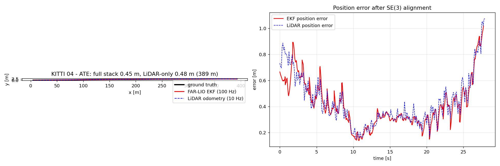
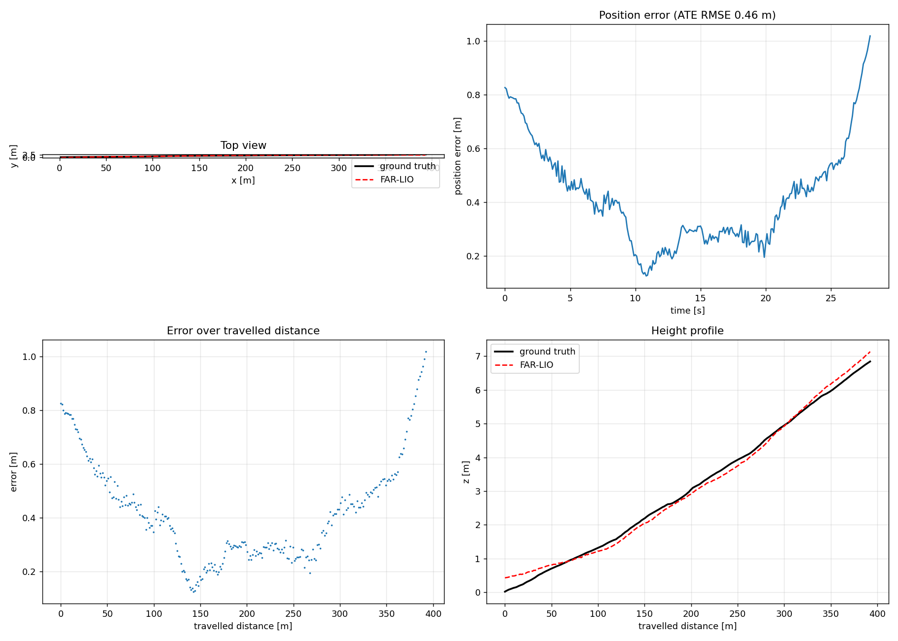
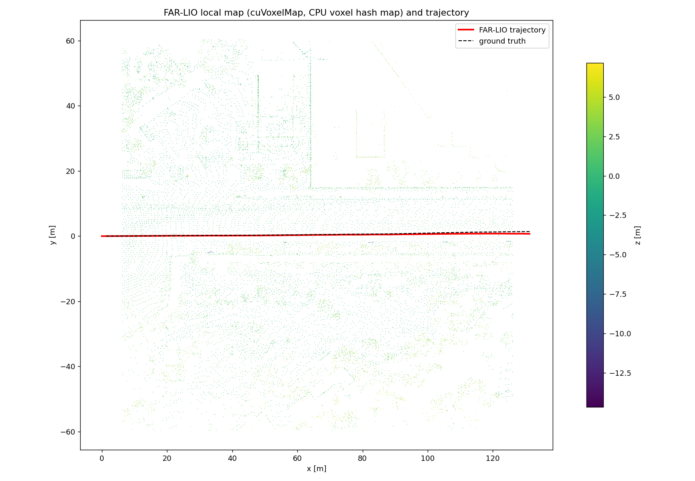

# FAR-LIO ROS 1 移植（Noetic）— 完整功能版

本目录是 [TUMFTM/FAR-LIO](https://github.com/TUMFTM/FAR-LIO)（官方版）在 **ROS 1 Noetic / Ubuntu 20.04**
上的**全功能移植**：LiDAR 里程计 + 100 Hz EKF 状态估计（IMU 紧耦合）+ 定位模式 + 多雷达前端
+ 地图服务 + TSL 调试 + 看门狗/诊断，全部可用。

上游仓库本体保持原样放在 `../FAR-LIO`（ROS 2 Jazzy + CUDA 工程，带 `CATKIN_IGNORE` 不参与构建）。
算法库（`lib_cpp/odometry_cpp`、`lib_cpp/state_estimation_cpp`）**源码零改动**，只重写 ROS 接口层，
并对上游 CMake 做了少量构建适配（见 `docs/PORTING_NOTES.md`）。



---

## 1. 实测结果（官方 KITTI Odometry 04 测试包，ROS 2 bag → ROS 1 bag）

| 运行模式 | 帧率 | 路径 | ATE RMSE | 终点误差 | RPE(1 m) |
|---|---|---|---|---|---|
| **完整栈：GICP(gicp_ext) + 3D EKF** | 100 Hz 输出 | 388.8 m | **0.452 m（0.12 %）** | 1.018 m（0.26 %） | 4.25 % |
| 仅 LiDAR 里程计（同一 bag，作为对照） | 10 Hz | 388.8 m | 0.478 m（0.12 %） | 1.075 m（0.28 %） | 7.84 % |
| 纯激光 gicp_cv 独立模式（无 EKF） | 10 Hz | 392.3 m | 0.464 m（0.12 %） | 1.018 m（0.26 %） | 3.65 % |
| 定位模式（加载先验 PCD 文件） | 10 Hz | 391.0 m | 0.468 m | 1.019 m | 3.10 % |
| 定位模式（经 `GetPointCloudMap` 地图服务） | 10 Hz | 391.0 m | 0.462 m | 0.997 m | 3.22 % |
| 双雷达合并（合成测试，245k 点/帧） | 10 Hz | 103.6 m | 0.088 m | 0.129 m | 2.17 % |

- 单帧 GICP（124k 点，8 线程 CPU）19–45 ms，10 Hz 实时；EKF 100 Hz 每周期 <1 ms。
- 5 个 EKF 变体（2D/3D × Kinematic/NonHolonomic/SingleTrack）全部编译并实测可初始化。
- 结果原始数据/评测在 `data/far-lio/results/`（`full_stack/`、`localization/`、`localization_service/`、
  `multi_lidar/`、`maps/`）。





---

## 2. 目录结构

```
lio_ws/
├── src/
│   ├── FAR-LIO/                 # 上游官方仓库（ROS 2），带 CATKIN_IGNORE，作为算法源码使用
│   └── farlio_ros1/
│       ├── farlio_odometry/     # ★ 主 catkin 包
│       │   ├── src/
│       │   │   ├── farlio_odometry_node.cpp          # 里程计/定位节点（gicp_cv/gicp_ext/icp_*）
│       │   │   ├── multi_lidar_merger.cpp            # 多雷达前端融合
│       │   │   ├── map_server.cpp                    # GetPointCloudMap 地图服务
│       │   │   └── state_estimation_{2d,3d}_*.cpp    # 5 个 EKF 可执行文件
│       │   ├── include/farlio_odometry/estimation/   # EKF 节点：node/helper/types/watchdog/
│       │   │                                        #   monitor/TSL/Ros1 类型转换
│       │   ├── config/  launch/  rviz/  scripts/
│       ├── farlio_msgs/         # ROS 1 消息/服务（IMU 车速、转向、TSL、GetPointCloudMap）
│       ├── vendor/              # TUM param/tsl/tum_types/tum_helpers/state_estimation（去 ament）
│       ├── thirdparty/          # Eigen 3.4.0（已打补丁）、Sophus、robin-map、boost/eigen3 shim
│       └── docs/
└── farlio_ws/                   # 独立 catkin 构建空间（不污染 lio_ws/build、lio_ws/devel）
```

> 为什么单独建 `farlio_ws`：`lio_ws` 里已有约 400 个包、且用 gcc-9 构建；本移植需要 C++20（gcc-10）
> 和 CMake ≥ 3.25，混用会触发全工作区重编译。源码仍在 `lio_ws/src`，符合你的目录要求。

---

## 3. 依赖与编译

### 3.1 工具链（本机已装好）

| 依赖 | 要求 | 本机状态 |
|---|---|---|
| ROS | Noetic（ROS 1） | ✅ `/opt/ros/noetic` |
| C++ | C++20（上游使用 `concepts`/`requires`） | ✅ `~/opt/gcc-10`（本地解包，无需 root） |
| CMake | ≥ 3.25 | ✅ `~/.local/bin/cmake` 3.28.3 |
| Eigen | 3.4（`Eigen::Vector<T,N>`） | ✅ vendored，不碰系统 3.3.7 |
| PCL / TBB / yaml-cpp / Boost | Noetic 自带 | ✅ |
| CUDA | 不要求（CPU 版）；CUDA 路径见第 8 节 | 本机无 nvcc |

### 3.2 编译

```bash
cd /home/komasa/lio_ws/src/farlio_ros1/farlio_odometry
./scripts/build.sh                 # 输出到 /home/komasa/lio_ws/farlio_ws
source /home/komasa/lio_ws/farlio_ws/devel/setup.bash
```

手动等价命令见 `scripts/build.sh` 或 `docs/PORTING_NOTES.md`。
脚本默认 `-j8`（EKF 模板实例化较吃内存，可用 `JOBS=N` 覆盖）；已验证从零构建可成功。

产物（`farlio_ws/devel/lib/farlio_odometry/`）：

```
farlio_odometry_node                          # 里程计 / 定位
farlio_odometry_multi_lidar                   # 多雷达合并
farlio_odometry_map_server                    # 地图服务
farlio_odometry_state_estimation_2d_kin       # EKF 变体（5 个）
farlio_odometry_state_estimation_2d_nh
farlio_odometry_state_estimation_3d_kin
farlio_odometry_state_estimation_3d_nh
farlio_odometry_state_estimation_3d_stm
```

> **本机特有**：`LD_LIBRARY_PATH` 里有海康 MVS SDK 的旧版 libusb，会覆盖系统库导致 PCL 报
> `undefined symbol: libusb_set_option`。运行前：
>
> ```bash
> export LD_LIBRARY_PATH=/usr/lib/x86_64-linux-gnu:/opt/ros/noetic/lib:/opt/ros/noetic/lib/x86_64-linux-gnu:$LD_LIBRARY_PATH
> ```

---

## 4. 跑官方 KITTI 04 测试包

### 4.1 ROS 2 bag → ROS 1 bag

```bash
cd /home/komasa/lio_ws/data/far-lio
rosbags-convert test-data-kitti-seq04/kitti_20110930_seq_04 --dst kitti_seq04_ros1.bag
```

话题：`/kitti/velo/pointcloud`、`/kitti/oxts/imu`、`/tf_static`、`/ground_truth`；帧：`base_link → imu_link → velo_link`。
该测试包点云字段是 `x y z i`，**没有逐点时间戳**，因此去畸变不生效（上游同样如此）；实车雷达有时间字段时会生效。

### 4.2 完整栈（里程计 + EKF，与上游 `docker compose --profile far-lio` 等价）

```bash
source /opt/ros/noetic/setup.bash
source /home/komasa/lio_ws/farlio_ws/devel/setup.bash
export LD_LIBRARY_PATH=/usr/lib/x86_64-linux-gnu:$LD_LIBRARY_PATH

roslaunch farlio_odometry farlio_full.launch \
  bag:=/home/komasa/lio_ws/data/far-lio/kitti_seq04_ros1.bag \
  rviz:=true
```

默认等价于上游的 `tam_cuda_gicp_ext + tam_state_estimation_node_ekf_3d_nh`：
`farlio_odometry_node`（`gicp_ext`，从 EKF 的 `/tf` 取初值）+ `state_estimation_3d_nh`。

话题：

| 话题 | 类型 | 说明 |
|---|---|---|
| `/core/state/lidar_odometry` | `nav_msgs/Odometry` | 激光里程计输出（送 EKF） |
| `/core/state/lidar_odometry_status` | `diagnostic_msgs/DiagnosticArray` | 里程计诊断（EKF 用作输入状态） |
| `/core/state/odometry` | `nav_msgs/Odometry` | **EKF 融合输出（100 Hz）** |
| `/core/state/acceleration` | `AccelWithCovarianceStamped` | EKF 加速度 |
| `/tf` | `tf2_msgs/TFMessage` | `local_cartesian → base_link`、`vehicle_cg → vehicle_velocity_cg` |
| `/core/orchestration/StateEstimation_status` | `diagnostic_msgs/DiagnosticArray` | EKF 节点诊断 |
| `/StateEstimation/tsl_values`、`/LidarOdometry/tsl_values` | `farlio_msgs/TSLValues` | TSL 调试时序（定义 latched） |

### 4.3 单独跑里程计 / 定位 / 多雷达

```bash
# 纯激光里程计（gicp_cv）
roslaunch farlio_odometry farlio.launch \
  config_file:=$(rospack find farlio_odometry)/config/kitti_seq04.yaml

# 定位模式（先验 PCD 文件）
roslaunch farlio_odometry farlio.launch \
  config_file:=$(rospack find farlio_odometry)/config/kitti_seq04_localization.yaml

# 定位模式（GetPointCloudMap 服务）
rosrun farlio_odometry farlio_odometry_map_server _map_path:=/path/map.pcd &
roslaunch farlio_odometry farlio.launch \
  config_file:=$(rospack find farlio_odometry)/config/kitti_seq04_localization_service.yaml

# 多雷达合并
roslaunch farlio_odometry farlio_multi_lidar.launch \
  input_topics:="/hesai/pandar,/livox/lidar"
```

### 4.4 评测

```bash
python3 $(rospack find farlio_odometry)/scripts/evaluate_trajectory.py \
  --bag run.bag --est-topic /core/state/odometry --out eval
```

输出 ATE/RPE（Umeyama SE(3) 对齐）和 2×2 图；`plot_map.py` 渲染 `/map` 俯视图。

---

## 5. 功能清单（相对上游）

### 5.1 里程计（`tam_odometry` → `farlio_odometry_node`）

- 模式：`gicp_cv`（GICP+匀速）、`icp_cv`、`gicp_ext`、`icp_ext`（外部初值，配合 EKF）；
- 建图模式 / 定位模式（`pipeline.update_map`）；
- 去畸变（按 `/tf` 采样位姿，10 ms 栅格、200 ms 窗口）、预处理、降采样；
- 自适应阈值、鲁棒核、协方差模型、诊断（时间差/前向/速度/椭圆门限）全部沿用上游库；
- 发布 `nav_msgs/Odometry` + `<output>_status` 诊断 + `<output>_path` + 可选 debug 点云；
- `~save_map` 服务保存 PCD；
- 地图服务：`node.input_map` 指向 `GetPointCloudMap` 服务时自动请求初始地图；`node.update_map_srv`
  + `<srv>_ready` 触发异步换图（`request_map_switch`）——两者均已实测（53222 点换图成功）；
- 点云超时看门狗；
- TSL 调试发布（`~tsl_definition` latched + `~tsl_values` 10 Hz）；
- 逐点时间戳：`t/time`(float32 相对秒)、`timestamp`(float64 绝对秒)、`offset_time`(uint32 ns，Livox)、
  uint32 纳秒（Ouster）。

### 5.2 状态估计（`tam_state_estimation_node` → 5 个 `state_estimation_*`）

- **5 个变体**与上游一一对应：`2d_kin`、`2d_nh`、`3d_kin`、`3d_nh`、`3d_stm`
  （2D/3D EKF × Kinematic/NonHolonomic/SingleTrack）；
- 100 Hz 运动学 EKF，IMU 预处理（FIR 滤波、偏置、备份 IMU）、参考姿态估计、车辆模型
  （轮速/转向/单轨侧偏角）；
- 声明式传感器配置：`measurements.<name>`（位姿/姿态/速度融合，R、outlier bounds、mask、
  additional delay、status topic）、`inputs.imus.<name>`（topic、滤波系数、backup）；
- 延迟补偿（`DelayCompensation`）、协方差随延迟放大、马氏距离/硬阈值外点剔除、协方差自适应、
  从测量初始化、状态机（`no valid imu` / `no valid: loc lin_vel` 等状态消息完全保留）；
- 发布 `/core/state/odometry`、`/core/state/acceleration`、TF（含侧偏角 `vehicle_velocity_cg`）、
  诊断、TSL；
- 超时处理（测量/IMU/轮速/转向），状态订阅与里程计状态联动。

> 上游节点通过 ROS 2 参数 overrides 枚举传感器配置；ROS 1 移植从 YAML 读取同名键
> （`measurements.*`、`inputs.imus.*`），语义不变。

### 5.3 多雷达（`farlio_odometry_multi_lidar`）

任意 N 个 `PointCloud2` → 外参变换到 `base_link` → 拼接 → 输出 `x y z [intensity] time`，
送入一个 FAR-LIO。成组条件：每话题一帧且时间跨度 ≤ `max_stamp_delta`（默认 20 ms）。
要求雷达间硬件同步（PTP/PPS）与准确外参。实测（双雷达合成数据）ATE 0.088 m/103.6 m。

### 5.4 地图服务（`farlio_odometry_map_server`）

加载 PCD，按请求 `voxel_size` 体素降采样，返回 `sensor_msgs/PointCloud2`，
服务类型 `farlio_msgs/GetPointCloudMap`。配合 `node.input_map` 服务名与
`node.update_map_srv` 异步换图，等价于上游 `tum_map_msgs` 流程。

---

## 6. 雷达适配

核心不挑品牌/线数，要求：`PointCloud2` + x/y/z，建议有逐点时间戳。

| 雷达 | 配置 | 说明 |
|---|---|---|
| Velodyne HDL-64（KITTI） | `config/kitti_seq04*.yaml` | 无逐点时间，去畸变不生效 |
| 禾赛 64 线 | `config/hesai64.yaml` | `timestamp`(float64 绝对秒) 自动识别 |
| Livox Avia/Mid360/Airy | `config/livox_mid360.yaml` | `offset_time`(uint32 ns) 已支持 |
| Ouster / RoboSense | 通用 | 满足上述字段即可 |

改 YAML 的 `node.cloud_frame`（与 `/tf_static` 一致）、`node.input_pointcloud`、`map.voxel_size`、
`preprocessing.crop_range/crop_footprint` 即可；节点启动时等待 `base_link → cloud_frame` 静态外参。

---

## 7. 建图 vs 定位

| 模式 | 配置 | 行为 |
|---|---|---|
| 建图/里程计 | `pipeline.update_map: true` | 在线局部地图，从原点开始 |
| 纯定位 | `update_map: false` + `node.input_map`（`.pcd` 或服务名） | 加载先验地图，只配准不改图 |

定位初值：`localization.initial_pose: [x,y,z,roll,pitch,yaw]`，或 `node.wait_tf: true`
等待 `/tf` 的 `odom_frame → child_frame`（接外部 EKF/组合导航）。建图后 `rosservice call /save_map`
保存 PCD。

> 完整栈里 EKF 负责发 `/tf`，里程计 `gicp_ext` 从 TF 取初值；单独定位时里程计自己发 TF，
> 二者不会互相覆盖（移植里已按上游规则限制 TF 发布权）。

---

## 8. GPU / CUDA

- 上游本身是 CUDA 加速（ROS 2 Jazzy + CUDA 12.8），也支持 `BUILD_CUDA=OFF` 纯 CPU（本移植用的路径）。
- 本机 Ubuntu 20.04、无 CUDA toolkit，故默认 CPU：124k 点/帧 19–45 ms，10 Hz 单雷达实时；
  双雷达 245k 点约 140 ms。
- 装 CUDA 12.x 后可把 `lib_cpp/odometry_cpp` 以 `BUILD_CUDA=ON` 编译，并在移植里加
  `CUDA_GICP_CV` 配置类型（复制 `GICP_CV`，把 MAP/PREPROCESSING/REGISTRATION/DISTORTION 换成
  `CUDA_*`），ROS 1 节点层不用改；或直接用上游 Docker 镜像跑 ROS 2 版本。

---

## 9. 与上游的差异

### 9.1 算法源码

`lib_cpp/odometry_cpp`、`lib_cpp/state_estimation_cpp` 的算法源码**未修改**。
仅 `lib_cpp/odometry_cpp/CMakeLists.txt` 有 4 处构建适配（`ROS1-PORT` 注释标记，见
`docs/upstream_cmake.patch`）：

- Eigen/param_management/tsl 的 `find_package` 改为“已有 target 则跳过”；
- 系统 TBB 替代 FetchContent oneTBB；
- gtest 仅在 `BUILD_TESTING` 时下载；
- Sophus/robin-map 指向本地 vendored 副本（离线可编译）。

### 9.2 ROS 层重写（功能等价）

| 上游 ROS 2 | ROS 1 移植 |
|---|---|
| `rclcpp` 节点/组件/插件 | `roscpp` 可执行文件（EKF 5 个变体独立可执行） |
| `param_management_ros2_integration` | YAML → `tam::pmg::init()`（参数键与语义一致） |
| `ros2_watchdog_cpp`（TopicWatchdog/NodeMonitor） | 等价 ROS 1 实现（`topic_watchdog.hpp`、`node_monitor.hpp`），诊断话题/字段一致 |
| `tsl_ros2_publisher_cpp` | ROS 1 版本（`farlio_msgs/TSLDefinition`、`TSLValues`，latched 定义 + 10 Hz 值） |
| `tum_map_msgs/GetPointCloudMap`（文件路径） | `farlio_msgs/GetPointCloudMap`（直接返回 PointCloud2） |
| `tum_msgs` 车速 / `autoware_auto_vehicle_msgs` 转向 | `farlio_msgs/TUMFloat64PerWheelStamped`、`SteeringReport` |
| `tum_type_conversions_ros_cpp` | ROS 1 版本 `estimation/ros1_conversions.hpp`（函数名/语义一致） |
| ROS 2 参数热更新（on-set callback） | 100 Hz 检查参数 hash 热更新（保留） |

### 9.3 已知限制

- 本机无 CUDA toolkit，未构建 GPU 路径（CPU 已实时跑通；GPU 路径见第 8 节）；
- KITTI 测试包无逐点时间戳，去畸变不生效（数据本身如此）；
- 地图服务返回点云而非临时文件路径（接口等价，少一次磁盘 IO）；
- 多雷达融合依赖雷达间时间同步，未同步时会退化（已给出 `max_stamp_delta` 保护）。

---

## 10. 常用命令速查

```bash
# 编译
cd /home/komasa/lio_ws/src/farlio_ros1/farlio_odometry && ./scripts/build.sh

# 环境
source /opt/ros/noetic/setup.bash
source /home/komasa/lio_ws/farlio_ws/devel/setup.bash
export LD_LIBRARY_PATH=/usr/lib/x86_64-linux-gnu:$LD_LIBRARY_PATH

# 完整栈 + 官方 bag
roslaunch farlio_odometry farlio_full.launch \
  bag:=/home/komasa/lio_ws/data/far-lio/kitti_seq04_ros1.bag rviz:=true

# 定位（服务）
rosrun farlio_odometry farlio_odometry_map_server _map_path:=/path/map.pcd &
roslaunch farlio_odometry farlio.launch \
  config_file:=$(rospack find farlio_odometry)/config/kitti_seq04_localization_service.yaml

# 多雷达
roslaunch farlio_odometry farlio_multi_lidar.launch input_topics:="/hesai/pandar,/livox/lidar"
```
